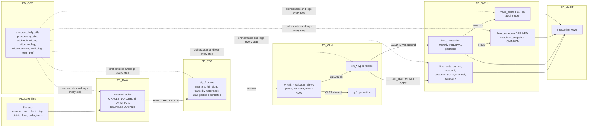
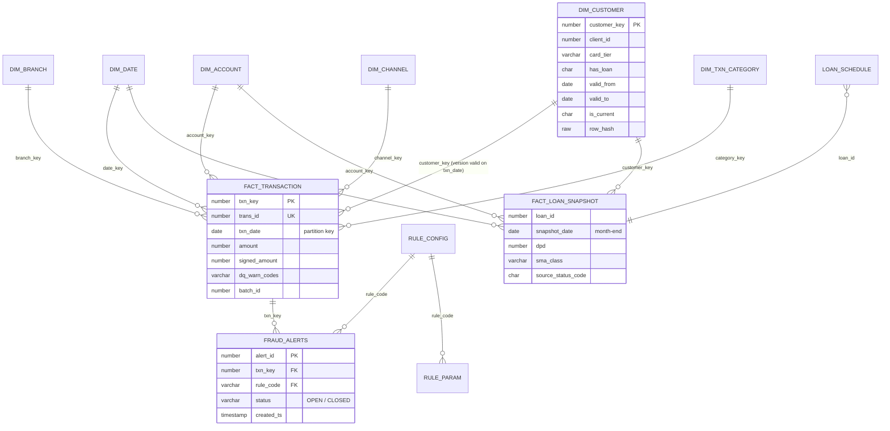

# **FinData Warehouse**: Banking Data Warehouse & ETL Automation using Oracle PL/SQL

A loan-risk and transaction-monitoring warehouse built on Oracle Database 23ai Free. All ETL logic is PL/SQL. The data is
the real PKDD'99 Czech bank dataset: 1,056,320 transactions, 4,500 accounts, 682 loans, 1993-1998.

## The problem

A retail bank's raw extracts arrive as flat files with Czech codes, placeholder values (`?`), two-digit years, a
birth number that hides the client's gender, and running balances that do not always add up. Risk and compliance teams
need four things from them:

* a trusted, reconciled history of every transaction, loadable incrementally every night;
* point-in-time customer attributes (what card did the client hold *when* the payment happened?);
* an early-warning view of loans: days past due and a regulator-style SMA / NPA bucket at every month-end;
* rule-based alerts on suspicious transactions, with a reviewable and audited case status.

They also need the run itself to be operable. That means logs per step, a clean failure, replay of one failed step,
no duplicates on re-runs, and tests that prove all of this.

## Architecture



Every arrow is a PL/SQL package (`fd_raw.pkg_raw_check`, `fd_stg.pkg_stage`, `fd_cln.pkg_clean`,
`fd_dwh.pkg_load_dwh`, `fd_dwh.pkg_risk`, `fd_dwh.pkg_fraud`). `fd_ops.pkg_orchestrator` runs them in the order given by
`fd_ops.etl_step`. Python is used only to download the files (`scripts/download_data.py`, standard library, SHA-256
verified).

## Data model



Full column-level definitions, code translations and rule catalogues: [docs/data_dictionary.md](docs/data_dictionary.md).

## Run it

Prerequisites: Docker with Compose, Python 3 and bash. On Windows, run it from WSL 2. About 3 GB of RAM goes to the
container.

```bash
git clone https://github.com/Utkal059/findata-warehouse.git
cd findata-warehouse
bash scripts/run.sh
```

That one command downloads and verifies the dataset, starts Oracle 23ai Free in Docker and waits until it is healthy.
It then runs `scripts/run_all.sql`, which builds everything from an empty database, loads six yearly batches and
measures performance before and after tuning. Next it runs the test suite, and finally it regenerates
[docs/run_results.md](docs/run_results.md) and [docs/performance.md](docs/performance.md) from the database.

Step by step instead:

```bash
python3 scripts/download_data.py
docker compose -p findata -f docker/docker-compose.yml up -d --wait
bash scripts/sqlplus.sh scripts/run_all.sql
bash scripts/sqlplus.sh sql/90_tests/run_tests.sql
```

`scripts/sqlplus.sh` runs SQL*Plus inside the container as SYSTEM. The password stays inside the container, and
`ORACLE_PASSWORD` overrides the local default. With your own Oracle instance, run `@scripts/run_all.sql` from the
repository root as a DBA user in a PDB. It prompts for `fd_app_password`, the password of the two login accounts, and
expects the data files in the directory that `sql/00_setup/02_create_directories.sql` points to.

CI ([.github/workflows/ci.yml](.github/workflows/ci.yml)) does the same on every push and pull request. It uses a
referentially consistent 10% sample: every 10th account with all of its rows (`scripts/make_ci_sample.sh`).

## Results (latest run)

These figures come from a single run on 2026-10-27: Oracle AI Database 26ai Free 23.26.3 in Docker on a laptop (WSL 2).
The full evidence is in [docs/run_results.md](docs/run_results.md) and [docs/performance.md](docs/performance.md), both
generated from the database by the run itself.

**Build and load**

* `scripts/run_all.sql` from an empty database took 566 s in total. That covers building every object, loading 6
  yearly batches (8 min 19 s) and measuring performance before and after tuning. The test suite took 1 min 54 s more.
* All 1,056,320 transactions reconcile at every hop: file lines = RAW = STAGING = CLEAN = `fact_transaction`, and the
  amount (6,257,793,560.30 CZK) is the same in CLEAN and the fact.
* No row was rejected, because the real files are clean. 47,716 transactions (4.5%) carry an R004 running-balance
  warning; they are kept and flagged.
* `fact_transaction` has 73 partitions: one INTERVAL partition for each of the 72 months, plus the initial one.
  `dim_customer` has 6,864 versions for 5,369 clients (1,279 clients with two versions, 108 with three).

**Loan early warning.** This compares the worst DERIVED class each loan reached with the status the bank delivered.
The status was never used to compute the class.

| loan.status | STANDARD | SMA-0 | SMA-1 | SMA-2 | NPA | Loans |
|---|---:|---:|---:|---:|---:|---:|
| A finished, paid | 201 | 0 | 0 | 0 | 2 | 203 |
| B finished, not paid | 0 | 0 | 0 | 0 | 31 | 31 |
| C running, OK | 401 | 1 | 1 | 0 | 0 | 403 |
| D running, in debt | 1 | 15 | 5 | 9 | 15 | 45 |

Every defaulted loan (B) reaches NPA, and 44 of the 45 loans the bank marks "in debt" (D) fall into an SMA or NPA
class. 603 of the 606 healthy loans (A and C) never go beyond SMA-0. At 1998-12-31 the book held 412 STANDARD, 16 SMA-0,
6 SMA-1, 9 SMA-2 and 48 NPA loans.

**Transaction monitoring.** There are 514 alerts in total:

| Rule | Alerts | Accounts |
|---|---:|---:|
| F01 large outflow within 30 days of opening (HIGH) | 90 | 76 |
| F02 debit after 90+ days without client activity (HIGH) | 5 | 5 |
| F03 >= 90% of a >= 50,000 CZK credit leaves within 3 days (MEDIUM) | 61 | 47 |
| F04 2+ same-day cash amounts between 45,000 and 49,999 CZK (MEDIUM) | 174 | 145 |
| F05 cash withdrawal >= 30,000 CZK in whole tens of thousands (LOW) | 184 | 170 |

Three of these alerts, explained:

1. **F01, alert 1.** Account 1071 was opened on 1993-05-10. On 1993-06-09, 30 days later, 42,600 CZK was withdrawn in
   cash. New accounts that are emptied quickly are a classic mule or bust-out signal.
2. **F03, alert 17.** Account 47 received a 52,886 CZK non-income credit. A 63,300 CZK debit (120% of it) left within 3
   days, on 1993-12-11. The money passed straight through instead of being used.
3. **F04, alert 21.** Account 2486 made two cash transactions of 45,000-49,999 CZK on 1993-05-11, 97,833 CZK in total.
   Cash credits in this data never reach 50,000 CZK, so amounts packed just under that line look like a split.

**Performance.** These are medians of 5 timed runs on the same SQL. BEFORE has no statistics and no bitmap indexes;
AFTER has LOCAL bitmap indexes, statistics and star transformation.

| Query | BEFORE ms | AFTER ms | Plan changed |
|---|---:|---:|---|
| Q1 region monthly flows, 1997 | 44.2 | 49.8 | no |
| Q2 card withdrawals by region, Q4 1998 | 8.6 | 6.1 | yes |
| Q3 top household payers, 1998 | 68.1 | 61.6 | yes |
| Q4 gold-card holders by month (SCD2), 1996 | 23.4 | 3.5 | yes |
| Q5 recent activity of NPA loans | 10.0 | 1.8 | yes |

Tuning paid off where a selective dimension filter could use a bitmap index. Q4 went through the customer-key bitmap
(6.7x) and Q5 through the account-key bitmap plus the new snapshot index (5.6x). Q1-Q3 read a large share of their
date range anyway, and partition pruning already limited them to the right months before tuning, so the gains there are
small or within noise. Q1 kept the same plan, and its ~6 ms difference is run-to-run variation. On a 1-million-row fact
that fits in memory, partitioning did most of the work.

**Tests.** 18 of 18 pass ([sql/90_tests/run_tests.sql](sql/90_tests/run_tests.sql)):

* RAW/STG/CLN/DWH reconciliation;
* no orphan keys;
* SCD2 has one current row, no overlaps, and point-in-time joins;
* SMA boundaries 0, 1, 30, 31, 60, 61, 90 and 91;
* DPD consistency;
* one partition per month;
* idempotent replay of a whole batch;
* failure injection, refusal of a new batch and replay;
* quarantine of synthetic bad rows for R001, R002, R003, R005, R006 and R007;
* the audit trigger;
* least-privilege grants.

## Design decisions

* **Layered schemas with least privilege.** Six schema-only accounts (`NO AUTHENTICATION`) own the objects. Each
  layer can read only the layer below it. Each layer package is executable only by `FD_OPS`. The two login accounts own
  nothing: `FD_ETL` can run and replay batches and close alerts, and `FD_REPORT` can read the `FD_MART` views. The `FD_`
  prefix keeps the project clear of Oracle's own `DWH`/`OPS`-style names and makes "drop everything" a one-liner.
* **RAW never rejects.** The external tables are all `VARCHAR2`, with `REJECT LIMIT UNLIMITED` and a BADFILE.
  RAW_CHECK compares each table's count with the file's data lines and fails the batch above `RAW_REJECT_TOLERANCE`
  (0). Typing happens in CLEAN, where a bad value becomes a quarantined row with a rule code instead of a lost line.
* **Validation as views, routing as one statement.** `v_chk_*` views compute typed columns and a `reject_codes` list
  per row. A single `INSERT FIRST` sends each row to `cln_trans` or `q_trans`, and the error-log rows go in the same
  transaction. Parsing uses `TO_NUMBER/TO_DATE ... DEFAULT NULL ON CONVERSION ERROR` inside scalar SQL macros, so the
  views stay pure SQL.
* **Incremental by watermark, replay-safe by batch.** STAGE takes the TRANS rows after the watermark up to the
  batch's as-of date. Every step deletes or merges by `batch_id` before writing, `fact_transaction.trans_id` is unique,
  and alerts are unique per (transaction, rule). Replaying any step of a batch therefore leaves the warehouse
  unchanged (test T12).
* **Logging that survives a rollback.** `fd_ops.pkg_etl_log` is `AUTONOMOUS_TRANSACTION`. A failing step rolls back
  its data, writes `FAILED` with the error and backtrace, and re-raises. The orchestrator then marks the batch FAILED
  and refuses to open a new batch until it has been replayed.
* **Business-dated SCD2.** `dim_customer` tracks card tier and loan holding. A new version starts on the date of the
  card issue or loan grant that caused it, not on the load date, so facts join to the version that was true at the time
  (test T08). A function-based unique index makes "one current row per client" a database guarantee.
* **R004 is a set check, not a row-order check.** The source has no intra-day sequence. On the 1993-1995 data, a naive
  previous-row balance check flagged 48% of rows, because month-end interest posts before the statement fee. The check that shipped flags a
  row only when no ordering of that day's transactions reconciles its balance (anti-join over candidate predecessors),
  which leaves the genuine source differences (4.5% of all rows).
* **Risk from evidence, not from the label.** `loan.status` is kept as delivered and is never used to compute DPD.
  DPD comes from a DERIVED schedule and the actual repayments, and `v_loan_status_vs_sma` then compares the two.
* **Thresholds as data.** Fraud thresholds live in `rule_param` and switches in `rule_config.is_active`, so tuning a
  rule is an `UPDATE`. Every alert carries a reason text that quotes the observed values and the threshold it crossed.
* **Physical design for a read-mostly star.** The fact is INTERVAL range-partitioned by month, so partitions appear as
  data arrives. Performance work adds LOCAL bitmap indexes on its dimension keys plus statistics. The gain is measured,
  not assumed (see [docs/performance.md](docs/performance.md)).

## Limitations

* **No Indian data.** The SMA-0/1/2 and NPA buckets are the RBI's day-count convention applied as a framework to Czech
  1990s loans. Nothing here describes an Indian or AU Small Finance Bank portfolio.
* **DERIVED schedule.** The source has no installment schedule, so the schedule assumes installment k is due
  `ADD_MONTHS(loan_date, k)`. Repayments always post on the 12th, so a loan granted late in a month can look one
  installment ahead or behind around month-ends. The source pays installments rounded to 0.1 CZK; a shortfall under 1%
  of one installment is treated as rounding.
* **Outstanding is principal-free arithmetic.** `outstanding_amount = loan amount - repayments`, because the data has
  no principal/interest split.
* **Fraud rules are uncalibrated.** The dataset has no fraud labels. Thresholds were chosen from the observed
  distributions to produce a reviewable volume. The alerts are leads, not findings.
* **Clean source.** The real files produced no REJECT rows. The quarantine path is proven with synthetic rows in test
  T15, and those rows are labelled as test fixtures and removed afterwards.
* **SCD2 starts at the first load.** History before the first batch is collapsed into the first version, which is
  valid from 1900-01-01.
* **Bitmap indexes and trickle loads.** Bitmap indexes suit this nightly batch pattern. A high-concurrency OLTP feed
  into the same fact would need B-tree indexes instead, or unusable-then-rebuild on the loading partition.
* **Timings come from a laptop.** All seconds and milliseconds are from one run in Docker on WSL 2 and will differ on
  other machines. The row counts and classifications are deterministic.
* **ClickHouse (optional phase 11)** was not built.

## RUNBOOK

All commands run as SYSTEM via `bash scripts/sqlplus.sh <file>`, or as `FD_ETL` in any SQL client.

**Nightly run**

```sql
EXEC fd_ops.proc_run_daily_etl(DATE '1998-12-31')
```

Check the result:

```sql
SELECT batch_id, as_of_date, status, error_msg FROM fd_ops.etl_batch ORDER BY batch_id DESC FETCH FIRST 1 ROW ONLY;
SELECT step_name, attempt_no, status, rows_read, rows_loaded, rows_rejected, error_msg
  FROM fd_ops.etl_log WHERE batch_id = :b ORDER BY log_id;
```

**A batch failed**

1. Find the failing step and its error: `etl_log` rows with `status = 'FAILED'`. `error_stack` holds the PL/SQL
   backtrace.
2. Data-quality detail is in `fd_ops.etl_error_log` (rule, source table, source key), and rejected rows are in
   `fd_cln.q_<file>`.
3. Fix the cause (data file, configuration or code), then replay that step and everything after it:

   ```sql
   EXEC fd_ops.proc_replay_step(p_batch_id => :b, p_step_name => 'CLEAN')          -- resumes LOAD_DWH..FRAUD
   EXEC fd_ops.proc_replay_step(p_batch_id => :b, p_step_name => 'CLEAN', p_resume => 'N')  -- this step only
   ```

4. New batches are refused (ORA-20002) while a batch is FAILED. Only a FAILED batch or the most recent batch can be
   replayed.

**Back-dated load requested**: refused by design (ORA-20003). The TRANS watermark never moves backwards.

**Failure drill** (what test T13-T15 does):

```sql
UPDATE fd_ops.etl_config SET param_value = 'LOAD_DWH' WHERE param_name = 'FAIL_AT_STEP'; COMMIT;
EXEC fd_ops.proc_run_daily_etl(DATE '1998-12-31')      -- fails with ORA-20990, batch FAILED
UPDATE fd_ops.etl_config SET param_value = NULL WHERE param_name = 'FAIL_AT_STEP'; COMMIT;
EXEC fd_ops.proc_replay_step(:b, 'LOAD_DWH')           -- batch SUCCESS
```

**Review and close an alert**

```sql
SELECT alert_id, rule_code, severity, txn_date, alert_reason FROM fd_dwh.fraud_alerts WHERE status = 'OPEN';
EXEC fd_dwh.close_fraud_alert(:alert_id, 'Customer confirmed the transfer by phone')
SELECT * FROM fd_ops.audit_log WHERE table_name = 'FD_DWH.FRAUD_ALERTS' ORDER BY audit_id DESC;
```

**Tune a rule**

```sql
UPDATE fd_dwh.rule_param SET param_value = 40000 WHERE rule_code = 'F01' AND param_name = 'MIN_AMOUNT';
UPDATE fd_dwh.rule_config SET is_active = 'N' WHERE rule_code = 'F05';
COMMIT;
```

New values apply from the next batch. Existing alerts are not re-evaluated.

**Rebuild from scratch**: `bash scripts/run.sh`. It drops and recreates every `FD_` schema.

## Repository layout

```text
docker/              Oracle 23ai Free container (compose file, start-up scripts)
scripts/             run.sh (one command), run_all.sql (build + load), sqlplus.sh, download_data.py, make_ci_sample.sh
sql/00_setup         schemas, grants, directories
sql/10_raw           external tables
sql/20_ops           batch control, logs, error/audit log, reference data
sql/30_stg           staging tables
sql/40_cln           clean + quarantine tables, parsing macros, validation views
sql/50_dwh           dimensions, fact, calendar
sql/60_risk          loan schedule and month-end snapshot
sql/70_fraud         rule catalogue, thresholds, alerts
sql/75_mart          reporting views
sql/80_perf          benchmark queries, harness, tuning, report
sql/90_tests         test suite
sql/95_report        run-results report
plsql/               one package per step + orchestrator + build gate
docs/                data dictionary, generated run results and performance report
```

## Data source

PKDD'99 Discovery Challenge, financial dataset (Petr Berka, University of Economics, Prague). The files are not stored
in this repository. `scripts/download_data.py` fetches them from the original archive or from pinned public copies, and
checks each file's SHA-256.
